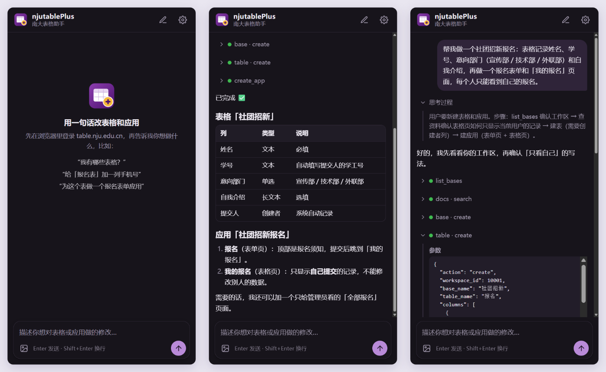

  

<h1 align="center">njutablePlus · 南大表格助手</h1>

在浏览器侧边栏里，用一句话创建和修改 <a href="https://table.nju.edu.cn">南大表格</a> 的表格与通用应用。

  

不用再一列一列点设置、反复翻帮助文档。告诉助手你要做什么，比如"做一个社团招新报名表，每个人只能看到自己的报名"。它会：
1. 先读你现有的表格；
2. 建表、建列、填数据；
3. 搭好表单页和表格页；
4. 最后用一张清单告诉你做了什么。

## 能做什么

- **表格**：
  - 新建表格、子表和各种类型的列（单选、日期、链接、公式、按钮……）；
  - 增删改行，管理视图和快照。
- **通用应用**：
  - 新建或修改应用，包括表单页、表格页、画廊、看板、日历、查询等页面；
  - 设置页面权限、角色、用户和邀请链接。
- **常见需求一句话完成**：
  - 每人只看到自己的记录；
  - 提交时自动填学工号和时间；
  - 一键"取消报名"按钮；
  - 先选时间段再选讲座；
  - 名额满了不能选；
  - 防止重复提交。
- **看懂图片**：直接粘贴截图，例如"照这个样子做"或"这里报错了"。助手也能把图片上传到表格里，用作表单配图或应用图标。

## 界面

- **流式回复**，支持 Markdown 表格、列表和代码。
- **思考过程、工具调用默认收起**：每一步只显示一行，绿点表示成功、红点表示失败，点开能看到完整参数和结果。
- **随时停止**：生成或执行过程中点停止，立即结束。
- **对话自动保存**：关掉侧边栏再打开，对话还在；点右上角铅笔开始新对话。
- 跟随系统的浅色、深色主题。

## 安装

1. 下载本仓库：点 **Code → Download ZIP**，解压到一个固定的文件夹（之后不要删除）。
2. 在 Chrome（或 Edge）地址栏打开 `chrome://extensions`，打开右上角的 **开发者模式**。
3. 点 **加载已解压的扩展程序**，选择解压出来的文件夹（里面有 `manifest.json`）。
4. 把 njutablePlus 固定到工具栏。点它的图标，就会打开侧边栏。

以后更新：下载新版覆盖原文件夹，在 `chrome://extensions` 里点刷新。

## 第一次使用

1. **准备模型密钥**：助手默认使用 [DeepSeek](https://platform.deepseek.com)。在 DeepSeek 开放平台注册并创建一个 API Key。
2. **填写设置**：打开侧边栏，点右上角齿轮，填入 API Key 后保存。
   - Base URL 和模型保持默认即可；
   - 也可以换成其他兼容 OpenAI 接口的模型服务，首次保存时浏览器会请求访问该网址的权限。
3. **登录南大表格**：在浏览器的一个标签页里登录 [table.nju.edu.cn](https://table.nju.edu.cn)，保持打开。助手通过这个登录状态操作你的表格。
4. 在侧边栏输入需求，按 Enter 发送（Shift+Enter 换行）。

## 试试这样说

- 我有哪些表格？
- 给「活动报名表」加一列手机号，并设为必填
- 为「社团招新」做一个报名表单，提交后跳到"我的报名"页面，每个人只能看到自己的报名
- 在"我的报名"里加一个取消报名的按钮，点了以后状态变成已取消
- 报名时先选时间段，再只能选这个时间段的讲座，每场讲座限 50 人
- （粘贴截图）把这个表单做成和图里一样

需求说得越具体越好：要哪些列、哪些页面、谁能看、谁能改。信息不全时，助手会先问清楚再动手。

## 安全与隐私

- **只用你自己的权限**：所有操作都在你已登录的南大表格页面里进行。你没有权限的表格，助手也碰不到。
- **不保存你的密码**：插件不读取、不保存南大表格的账号密码。
- **密钥只存在本机**：API Key 只保存在本机浏览器的扩展存储里，只发给你设置的模型服务。
- **改应用前先存档**：每次修改或删除应用前，插件会把原来的配置存在本机；也可以让助手先给表格或应用建快照。
- **先检查再写入**：应用配置写入前会先在本地检查。字段名写错、引用了不存在的列、权限项写错等问题会在写入前拦下，不会把应用改坏。
- **删除只进回收站**：删除的表格会进入南大表格的回收站，可以恢复。
- **对话内容会发给模型服务**：发送的内容和表格结构会交给你设置的模型服务处理，请不要让它处理敏感数据。

## 已知限制

- 自定义页面、HTML 页面和单条记录页的版式只能在南大表格的应用编辑器里手动设计，助手只能设置这些页面的名称和权限。
- 自动化规则、旧版表单、Excel 导入导出暂不支持。
- 只支持图片附件。
- 需要保持一个已登录的 table.nju.edu.cn 标签页。

## 常见问题

**提示"没有找到 table.nju.edu.cn 的标签页"？**
先在浏览器里打开并登录 table.nju.edu.cn，再重新发送。

**提示登录已过期？**
刷新南大表格页面并重新登录。

**卡住不动了？**
点输入框右下角的停止按钮；若仍无反应，在 `chrome://extensions` 里刷新扩展。

**做出来的效果不对？**
直接告诉助手哪里不对，最好附上截图，它会读取当前配置再修改。

---

开发者说明

- 纯原生 JavaScript（ES Modules），无构建步骤，无运行时依赖。
- 目录：
  - `agent/`：对话循环和系统提示词；
  - `tools/`：24 个平台工具；
  - `checker/`：应用配置编译检查；
  - `knowledge/`：给模型查阅的平台资料；
  - `sidepanel/`：界面。
- 测试：`npm test`（需要 Node 20+）。
- 设计和接口记录见 [docs/](docs/)。

